[简体中文](README.md) · [English](README.en.md)

# WashDesk · 知华科技洗衣与干洗门店管理系统

**知华科技（上海如静知华信息科技有限公司）** · [官网](https://www.zhuatech.cn/)

顾客送来五件衣物，先取三件：查清另外两件是否洗好、挂在哪里、什么时候可取，以及零售欠款或企业月结是否结清。WashDesk 以每件衣物为单位处理**收衣 → 加工／质检／返洗 → 挂架 → 分批取衣 → 收款／企业月结**，不是酒店布草批量交接系统。

本项目为**公开源码学习版：源码公开、非商业使用**，适合个人学习和流程研究；商业使用须公司书面授权，遵循根目录 [LICENSE](LICENSE)，不是允许免费商用的MIT／Apache项目。第三方依赖保留各自许可。没有宣称已有实际客户、付费案例、生产运营或硬件认证。

## 谁使用，如何分工

适用洗衣／干洗门店及提供企业客户洗护服务的经营者，用于逐件识别、加工位置、分批交接和应收流程验证。单一经营主体支持多个门店数据范围，不是多租户SaaS。

|使用端／岗位|已实现操作|
|---|---|
|前台业务端|客户档案、逐件收衣、外观照片、标签预览、零售核实收退款、扫码编号核对、分批交接|
|加工质检业务端|本门店订单查阅、开始加工、质检通过、说明返洗理由、挂架／换架、位置查询|
|财务业务端|零售核实收退款、企业授信、冻结取完订单形成月结单、分次收款、结清、报表／导出|
|客户查单端|登录后查看绑定自己订单、照片、加工位置、已取明细及企业月结单，不能查看其他客户|
|管理员后台|登录账号、角色、固定权限目录、菜单、门店、IANA时区、洗护类别、照片／件数参数、审计|

角色名称可改，权限代码由真实接口固定；自定义岗位需要正确配置权限及范围。CUSTOMER角色仅可有本人查单权限，账号需绑定客户。已有业务历史后初次绑定允许，原有绑定不可转让。前台默认亦有人工收款权限，可由管理员另拆岗位；本版不强制双人质检或双人财务复核。

## 实际能力与业务边界

- 每件衣物独立编号、描述、外观／缺陷／确认记录和冻结服务收费；支持JPEG／PNG外观照片，鉴权访问、数据库持久化。每张≤2MiB、边长≤4096px且≤1200万像素，每件默认3张，可配1–5张，仅加工前上传。
- 合法工序和版本保护：待加工、加工中、待挂架、可取衣、已取走；返洗需原因，释放挂架，保留返洗次数与操作者。已取走衣物不能回加工。
- 门店挂架代码、容量、占用统计及换架；不能超容量，也不能停用仍占用的挂架。搜索支持订单、客户名称及完整衣物编号，键盘式扫描枪输入或手输；无摄像头扫码。
- 分批取衣逐件核对完整编号，拒绝非本单／非可取／重复编号，记录实际接收人、交接人、时间和各件身份；取走同步释放挂架。
- 零售预收和分次核实收款，足额后取衣；收款拒绝超额、重复凭据和重复命令。仅加工前取消，保留原因；退款必须绑定取消单原收款，不超过原款剩余余额。
- 企业月结接单核验累计授信额度；企业订单不直接收款。全单取完后，按客户和门店时区下的取完月份冻结未开单订单，支持补充月结单、打印和分次核实收款；应收转入月结单不重复统计。
- 整数最小货币单位、两位小数ISO货币，报表按币种拆分；CSV导出防公式注入。业务轨迹与认证／配置审计最近500条。
- 登录BCrypt12、30分钟HttpOnly／SameSite Strict会话、CSRF、失败节流、实时权限和门店／本人范围；停用／密码重置撤销旧会话，最后管理员保护。
- 中英文界面、移动端菜单与表格、业务搜索／筛选／20条分页、最新／最早／取衣日期排序；中文／英文名称支持经营者维护，不自动翻译录入内容。

**收款仅是人工核实台账，系统不自动扣款或确认第三方到账。月结单不是税务发票。** 未实现支付网关、短信、公众号、公共注册、多租户、自动传送线、洗衣机接口、摄像头扫码、独立质检双人复核、交接后退款、遗失损坏理赔和税务开票。第三方配置：核心功能无需付费第三方密钥；HTTPS、外部MySQL／CA、扫描枪及打印机环境由部署者配置和验证，没有预留适配器冒充已完成集成。

## 运行界面

下列图片来自当前代码实际运行页面，使用标明QA的测试资料；不是实际客户案例、虚构效果图或生产使用证明。

### 登录

独立管理员密码与双语登录。

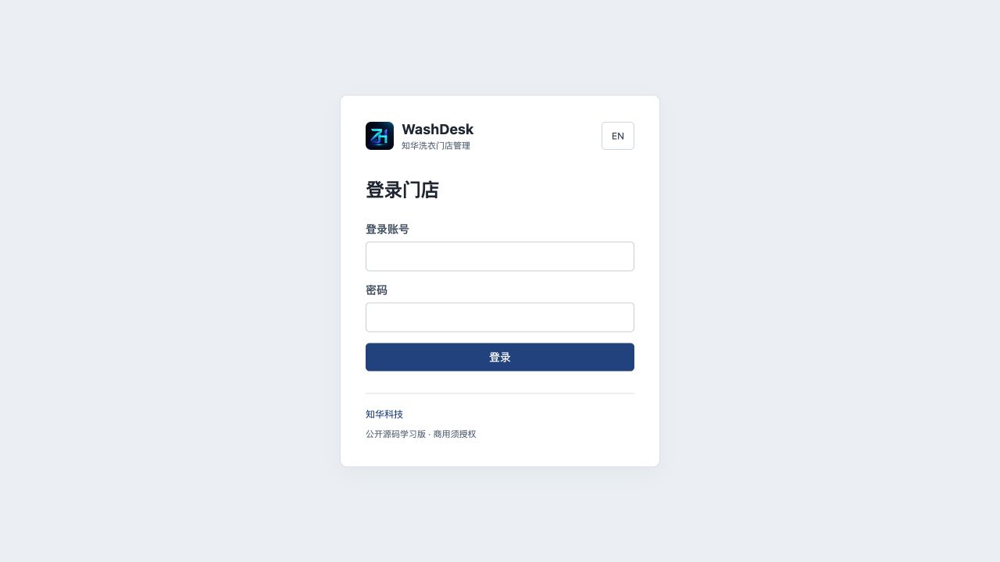

### 门店工作台

搜索、状态筛选、分页和订单进度。

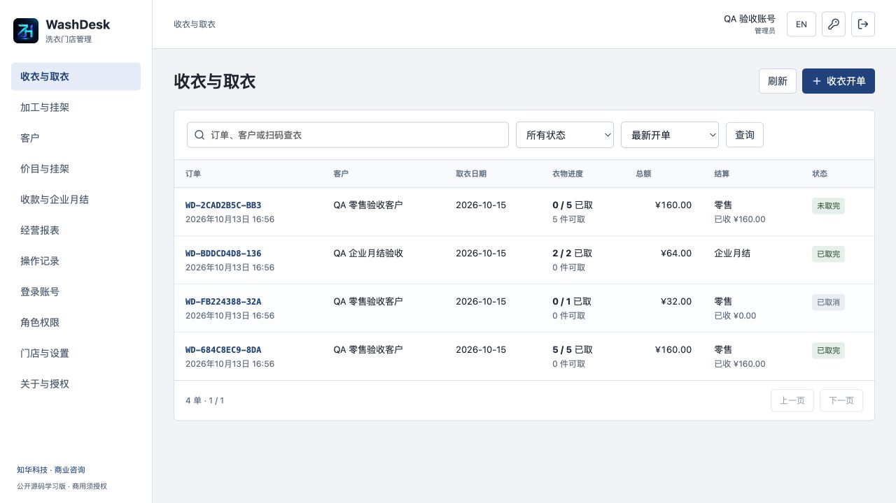

### 逐件收衣

逐件服务、外观缺陷和收费快照。

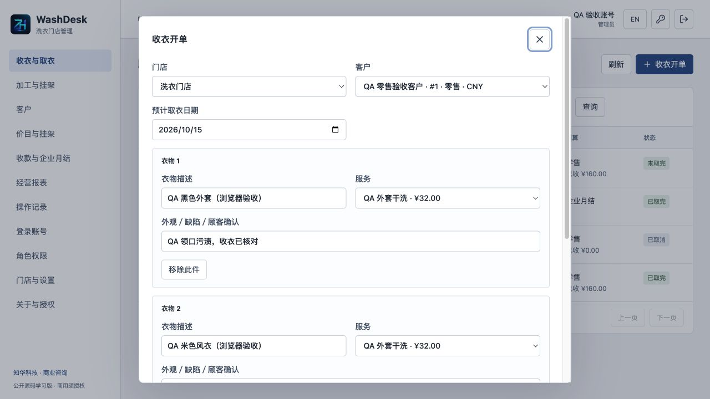

### 分批取衣

五件先取三件，剩余两件继续显示进度与挂架。

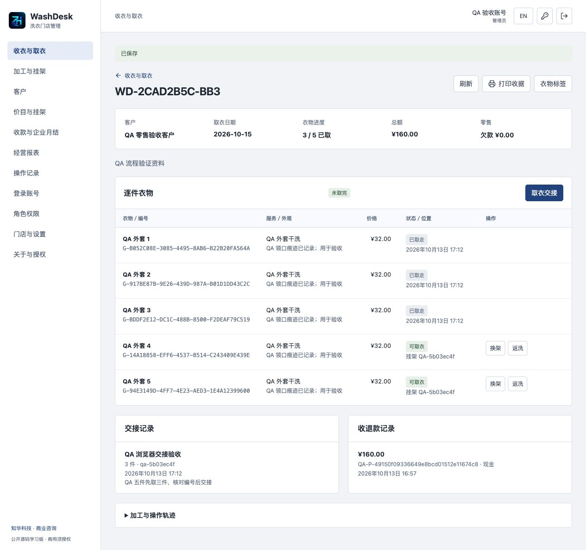

### 加工与挂架

加工、质检、返洗、挂架和位置。

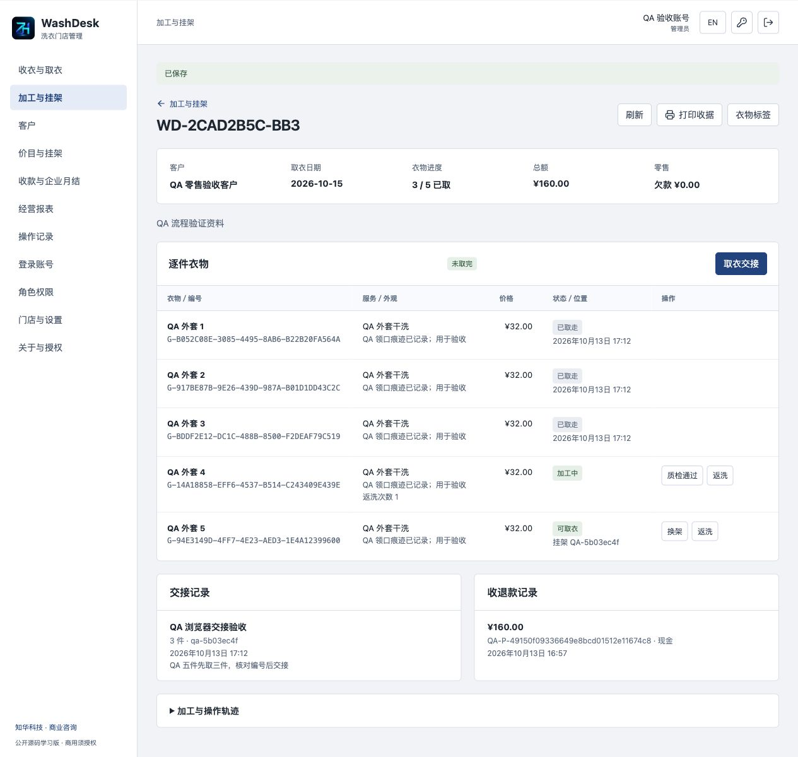

### 登录账号

维护登录、岗位和门店归属。

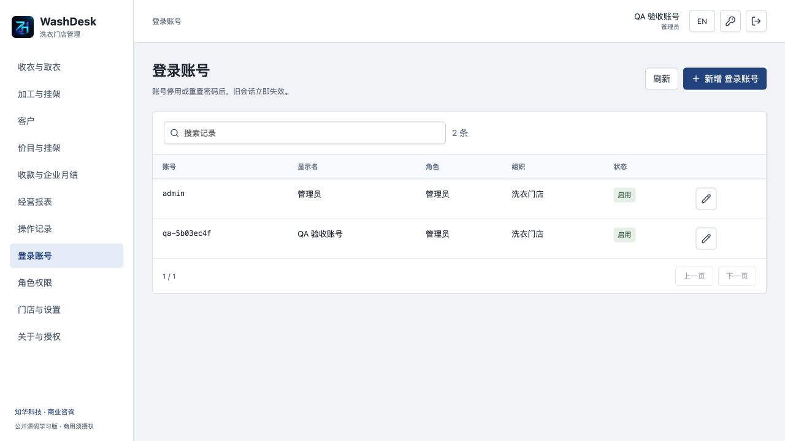

### 经营报表

按币种核实净收款与应收，无跨币种加总。

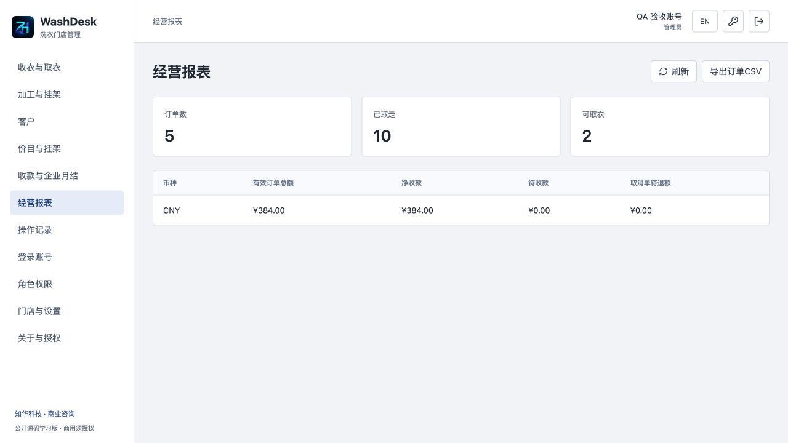

### 门店与参数

门店时区、类别、参数、菜单及权限维护。

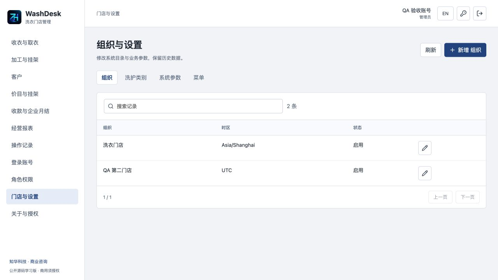

### 客户查单

客户只看绑定本人衣物和交接。

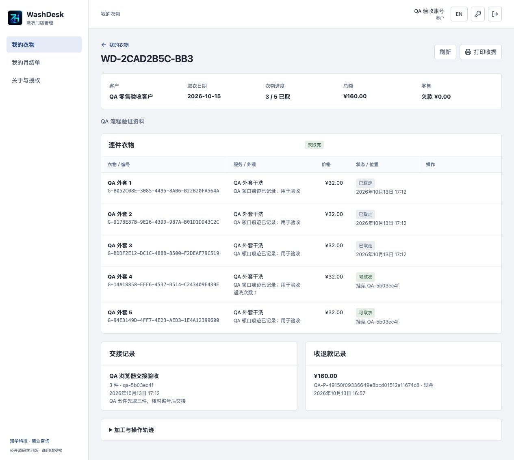

### 企业月结

冻结取完订单、核实收款、查询余额。

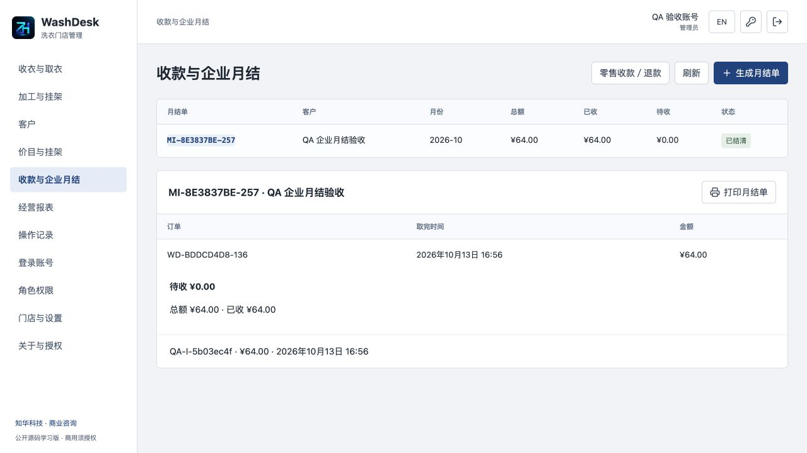

### 条码标签预览

运行数据产生Code128衣物标签，未认证实体硬件。

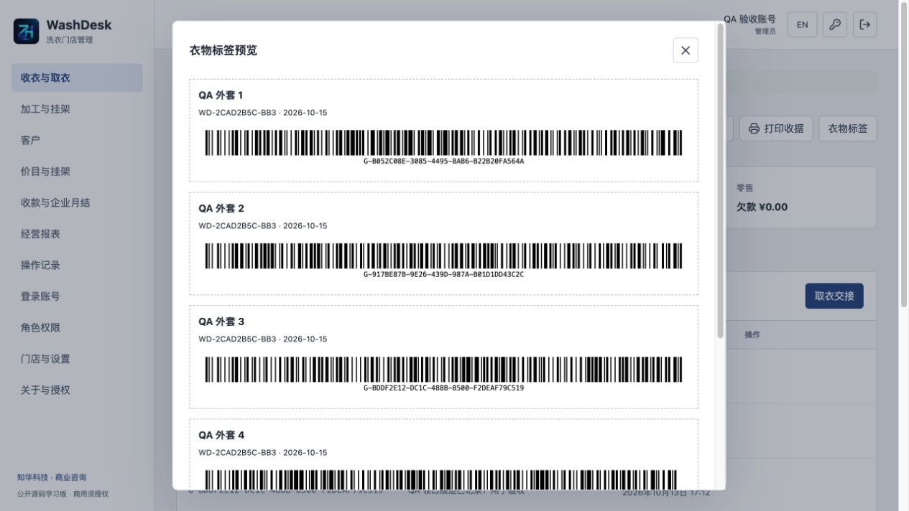

### 手机视图

窄屏菜单、订单详情和可滚动表格。

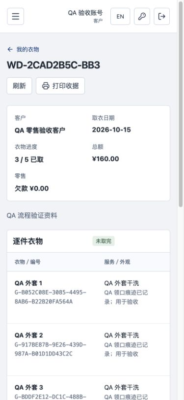

### 英文界面

中英文切换，保留经营者业务原文。

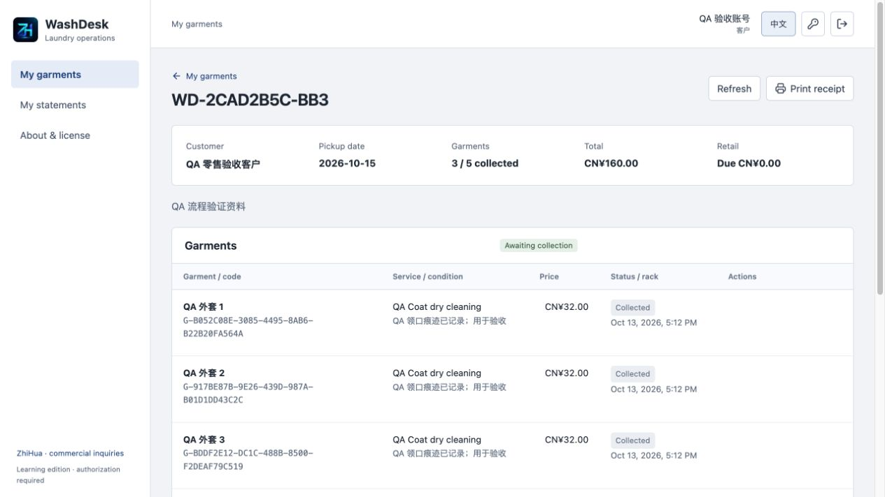

## 工程与运行环境

后端Java21、Spring Boot4.0.7、Security、JPA、Flyway、MariaDB Connector/J3.5.10（连接MySQL8.4）；前端Vue3.5.43、Vite8.1.5、JsBarcode3.12.3、Lucide。Node≥24.19.0、Maven3.9、Python3.10+、Docker Engine/Desktop与Compose v2。Docker启动不需本机Java／Node。建议4GB以上可用内存，按照片量规划数据库容量；未作压测或容量承诺。

```text
backend/               Java API、权限、衣物流程、照片和资金账
  src/main/resources/  application.yml、Flyway V1/V2迁移
frontend/              Vue界面、私有照片访问、Code128预览
  public/brand/        正式LOGO及两个原始微信二维码
scripts/               初始化、验收、备份、恢复、发布检查
compose.yaml           MySQL、后端、Nginx前端
compose.dev.yaml       仅供本机源码调试的数据库端口
.github/workflows/     前后端与全新MySQL验证流程
docs/                  操作、API、业务、安全、测试、部署与真实截图
```

浏览器→Nginx同源/api→Spring Security和业务事务→MySQL。实体与Flyway结构校验同时开启；照片作为私有BLOB随数据库备份，不产生公开静态地址。业务写入按统一行锁串行化，适合小容量流程研究；每类查询最多10000条，本版不是高并发或大规模经营交付承诺。

## 首次安装与启动

```sh
git clone https://github.com/zhuatech-han/zhuatech-washdesk.git
cd zhuatech-washdesk
python3 scripts/init-env.py
docker compose -p washdesk config --quiet
docker compose -p washdesk up --build -d --wait --wait-timeout 1800
```

访问 [本机前端](http://127.0.0.1:8158/)；健康检查 [actuator/health](http://127.0.0.1:8158/actuator/health)。默认管理员`admin`，密码由脚本生成并保存在**私有.env的ADMIN_PASSWORD**；请在本机读取，勿公开／共享／提交，没有固定演示密码。脚本拒绝覆盖已有.env，权限0600。重启不会覆盖已有账号密码，改.env不会重置密码。

首次空库执行 [V1身份迁移](backend/src/main/resources/db/migration/V1__identity.sql) 和 [V2洗衣迁移](backend/src/main/resources/db/migration/V2__laundry.sql)，建立表／外键／索引及Flyway历史；Bootstrap初始化账号、岗位、权限、菜单、类别和参数，不插入客户、衣物或虚构收费。先维护门店、服务、挂架、客户，再接单。

|配置名称|用途|
|---|---|
|MYSQL_ROOT_PASSWORD／DATABASE_PASSWORD|部署者独立数据库密码，必填|
|ADMIN_USERNAME／ADMIN_PASSWORD|仅首次管理员账号／12–72字节独立强密码，含大小写字母与数字|
|WEB_PORT／BIND_ADDRESS|默认8158／127.0.0.1，可覆盖占用端口|
|COOKIE_SECURE|本机HTTP默认false，HTTPS反代确认后true|
|DATABASE_URL／DATABASE_USER|可选外部MySQL，jdbc:mariadb://，外部连接要求sslMode=verify-full及可信CA|
|MYSQL_DEV_PORT|仅源码调试，本机数据库默认33158|

.env.example只列配置名字及安全说明；真实凭据不提交。数据库和后端默认不开放宿主端口。不同门店IANA时区决定取衣日期和月结月份，首单后锁定。

源码调试另开三个终端：

```sh
# 初始化.env后，只启动本机开发MySQL
docker compose -p washdesk-dev -f compose.yaml -f compose.dev.yaml up -d --wait mysql
# 后端：本机Java21、Maven3.9，脚本仅向子进程传私有变量
python3 scripts/dev-backend.py
# 前端：另一个终端
cd frontend
npm ci --no-audit --no-fund
npm run dev
```

Vite默认 <http://127.0.0.1:5173>，代理本机8080后端。不要同时在同一端口启动别的后端。正式部署使用Compose构建的Nginx，不使用Vite开发服务。

## 测试与交付验证

```sh
# 后端格式／单元／集成测试
mvn -B -f backend/pom.xml spotless:check test
# 前端
cd frontend
npm ci --no-audit --no-fund
npm run format:check
npm run lint
npm test
npm run build
# 回到仓库根目录，在独立新库上执行完整流程
cd ..
python3 scripts/quality.py --base http://127.0.0.1:8158 --state output/washdesk-quality-state.json
python3 scripts/verify-persistence.py --state output/washdesk-quality-state.json
python3 scripts/release-check.py
git diff --check
```

后端33项（7项纯规则、26项Spring Security/JPA/Flyway整合），前端11项。H2单测之外，另用真实MySQL8.4空卷启动、健康／登录、五件先取三件再取两件、返洗／挂架、资金／月结／取消退款、重复命令、客户和跨门店权限、照片字节核对、重启与隔离备份恢复；镜像构建不跳过测试。完整验收结果以交付记录为准。quality会创建QA资料，**仅可用于独立测试库**；其凭据状态文件mode0600不提交。未验证物理设备、真实支付、生产压测或外部经营使用。

## 部署、升级、安全与故障

[部署与备份恢复](docs/DEPLOYMENT.md)、[操作手册](docs/OPERATIONS.md)、[业务规则](docs/BUSINESS.md)、[API](docs/API.md)、[测试方式](docs/TESTING.md)、[安全说明](docs/SECURITY.md)。升级前备份并在独立目标演练，追加版本迁移，不编辑已执行SQL。backup短暂停止本项目后端写入，备份包括照片和散列；restore拒绝覆盖既有项目／卷／网络／占用端口，验证散列，仅恢复可信本地ZIP（SQL≤512MiB）。备份非加密，须控制权限和另行异地加密。

健康失败检查本项目mysql/backend日志和.env配置；构建下载失败修复包源网络后重试，不能跳过测试。端口占用修改WEB_PORT，不停止其他项目。502等待后端健康。无法登录核对首次初始化凭据／账号／门店状态；停用、重置密码或服务重启需重新登录。版本冲突先刷新，结果未知先核对记录。正式部署经营者须维护HTTPS、备份、最小权限、监控及隐私告知；本版登录限流在进程内，需反代再限流，未声称生产可用或安全认证。

## 授权、反馈与联系知华科技

仅限个人学习、技术研究与非商业交流，未经上海如静知华信息科技有限公司书面授权不得商用；收费部署、客户项目交付、SaaS运营、源码转售等需要商业授权。保留署名、官网及联系信息，详见 [LICENSE](LICENSE)；[第三方版权](docs/THIRD_PARTY.md)及原始许可独立适用。

贡献请附脱敏复现和对应测试，遵循[AGENTS.md](AGENTS.md)；一般问题使用仓库Issue，敏感漏洞通过官网或咨询入口私下报告，不公开客户照片／资料或凭据。源码按现状提供，使用风险和真实经营上线审查由部署者承担。

商业授权或深度定制开发请联系知华科技；服务包括源码商业授权、私有部署、软件定制、部署实施与系统集成。官网：<https://www.zhuatech.cn/>；微信`zhuatech`、`zhuatech2`。

本项目由知华科技（上海如静知华信息科技有限公司）提供公开源码学习版本，主要用于个人学习、技术研究与非商业交流。未经书面授权不得商用。企业信息化建设、中小企业数字化转型、中小企业 AI 转型、私有化部署、软件外包、软件项目外包、软件实施、FDE 外包、OPC 技术支持及深度定制开发，请访问知华科技官网 <https://www.zhuatech.cn/>，或添加微信 zhuatech、zhuatech2 咨询。

<table><tr><td align="center"><br>微信：zhuatech</td><td align="center"><br>微信：zhuatech2</td></tr></table>
